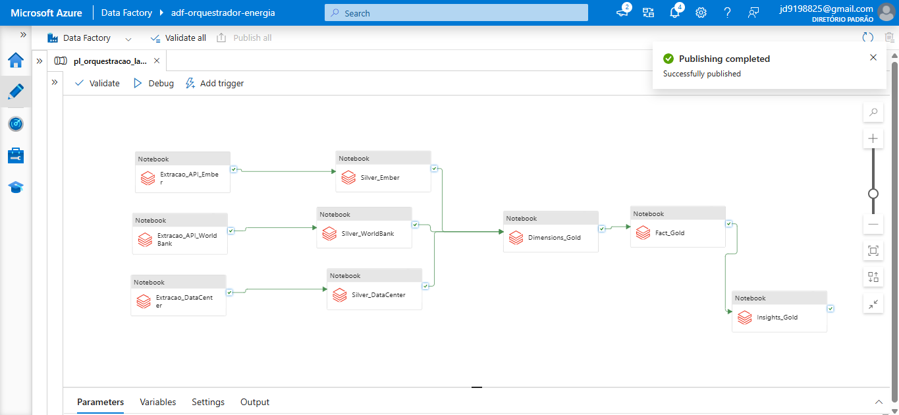
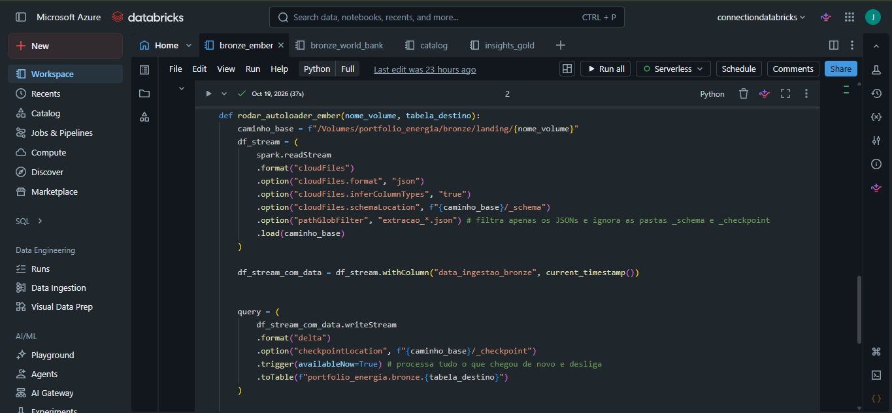
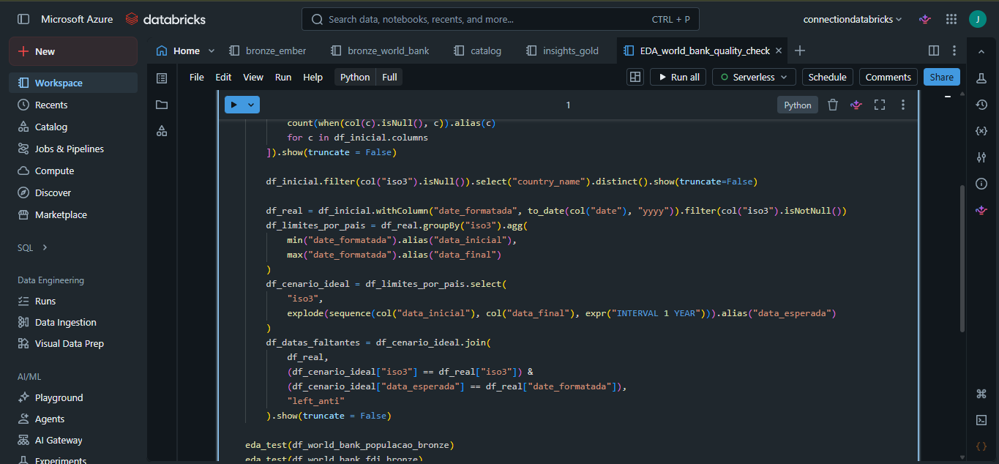
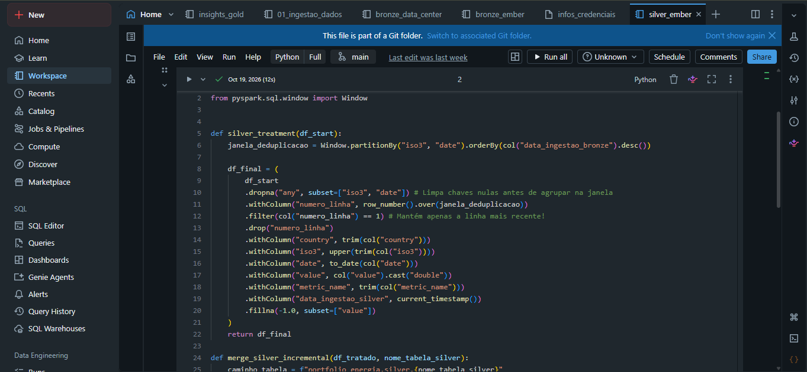
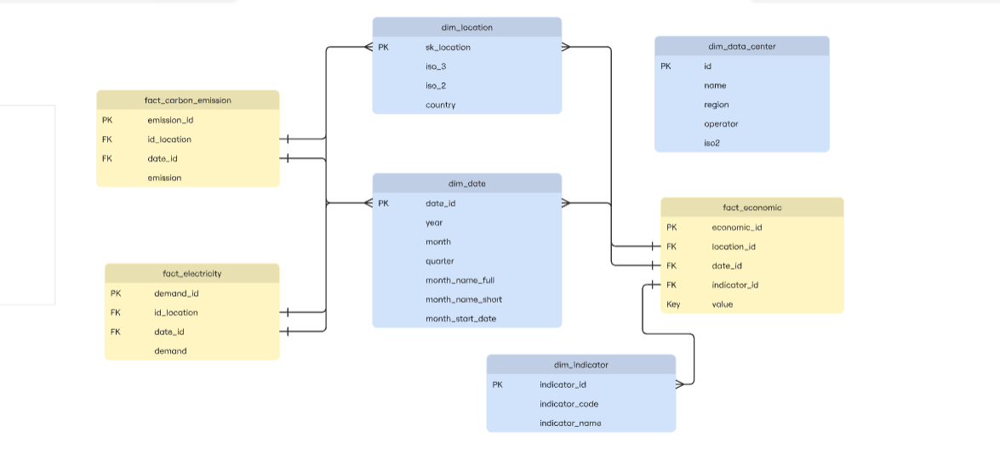
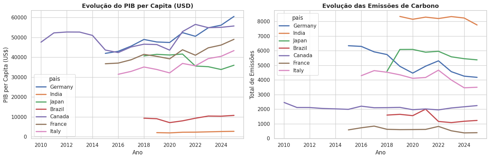
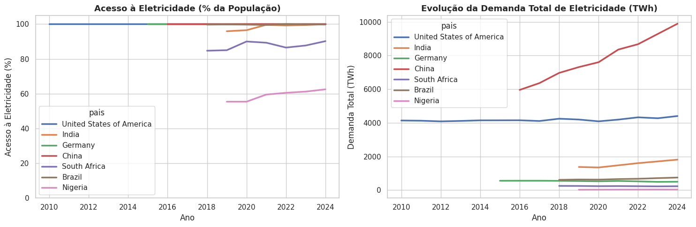
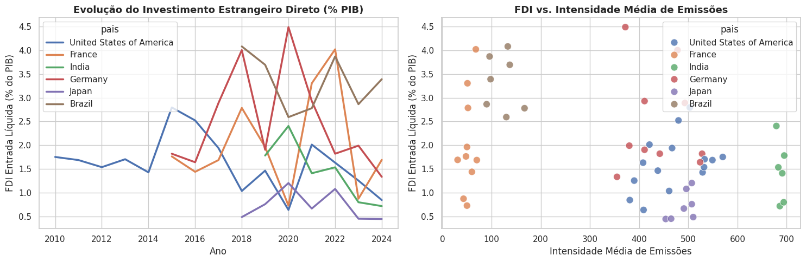
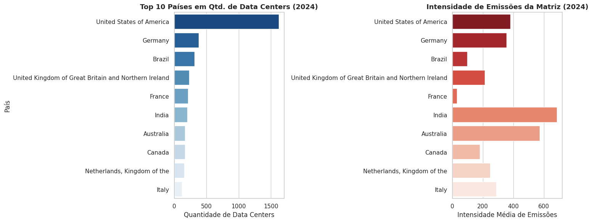

# Infraestrutura Global de Data Centers, Demanda Energética e Impacto Ambiental

Projeto de Engenharia de Dados utilizando Azure Data Factory, Azure Data Lake Storage Gen2 (ADLS Gen2), Azure Databricks, PySpark, Spark SQL, Delta Lake e Unity Catalog.

---

## Sobre o Projeto

O objetivo deste projeto é construir uma pipeline de dados ponta a ponta na nuvem (arquitetura Lakehouse) para analisar a relação entre a distribuição global de data centers, o consumo de eletricidade, a intensidade de emissões de carbono e o contexto socioeconômico dos países.

Durante a exploração inicial das fontes de dados, percebi que o catálogo do **Datacenters.world** trazia boas informações de localização e operação dos data centers, mas não possuía métricas energéticas. Para suprir essa lacuna, integrei os dados da **API da Ember** (que fornece o histórico mensal de demanda elétrica e emissões de carbono por país) e a **API do World Bank** (para cruzar essas informações com indicadores econômicos e demográficos, como PIB per capita, acesso à eletricidade e investimento estrangeiro direto).

---

## Tecnologias Utilizadas

* **Linguagens:** Python, SQL (Spark SQL) e PySpark
* **Cloud (Microsoft Azure):** Azure Data Factory (ADF), Azure Data Lake Storage Gen2 (ADLS Gen2), Azure Databricks, Access Connector e IAM
* **Lakehouse e Governança:** Apache Spark, Delta Lake, Databricks Auto Loader e Unity Catalog
* **Conceitos de Engenharia de Dados:** Arquitetura Medalhão (Landing, Bronze, Silver e Gold), Modelagem Dimensional, Carga Incremental Batch, Watermark, Schema Evolution, Idempotência (`MERGE INTO`) e Data Quality
* **Visualização de Dados:** Python (`seaborn` e `matplotlib`)

---

## Arquitetura e Etapas do Projeto

### 1. Ingestão de Dados e Fontes (APIs REST)

Os dados foram extraídos de três APIs públicas com características e granularidades diferentes, o que exigiu estratégias específicas de ingestão:

* **Datacenters.world API:** Extração de nome, operador, região, país (`ISO2`), latitude e longitude. Granularidade por instalação (data center).
* **Ember API:** Extração dos endpoints `carbon-intensity/monthly` e `electricity-demand/monthly`. Como a granularidade é mensal por país (`ISO3`), essa base foi o foco principal para implementação de carga incremental com Watermark e Auto Loader.
* **World Bank API:** Extração de quatro indicadores históricos anuais desde 1960 (PIB per capita em US$, População Total, % de Acesso à Eletricidade e Investimento Estrangeiro Direto - FDI). Foi implementada paginação na requisição para capturar cerca de 20.000 registros por indicador.

Para evitar repetição de código nas chamadas HTTP das APIs da Ember e do World Bank, encapsulei a lógica de requisição e salvamento em funções reutilizáveis em Python. Por questão de segurança, o arquivo com as chaves de API (`infos_credenciais`) foi mantido na raiz do Workspace, fora do diretório versionado pelo Git.

---

### 2. Carga Incremental, Watermark e Auto Loader (Landing -> Bronze)

Ao desenhar a camada Bronze no Unity Catalog, adicionei uma **Landing Zone** baseada em Volumes para que o **Databricks Auto Loader (`cloudFiles`)** pudesse monitorar a chegada de novos arquivos JSON e processá-los de forma incremental para as tabelas Delta.

Porém, apenas usar o Auto Loader na pasta não resolveria o problema de duplicidade na origem: se o script de extração sempre consultasse a API inteira, os arquivos JSON novos na Landing Zone trariam dados repetidos de anos anteriores. Para resolver isso, implementei o fluxo completo de **Watermark**:

1. Uma função consulta a tabela Delta da camada Bronze e retorna a data máxima já processada (`MAX(date)`).
2. Essa data é passada como parâmetro na requisição da API, buscando apenas dados novos ou atualizações recentes.
3. O retorno da API é salvo como JSON na Landing Zone (Volume no ADLS Gen2).
4. O **Auto Loader** lê apenas os arquivos ainda não processados e grava na tabela Delta Bronze, utilizando `inferColumnTypes` e `schemaLocation` para garantir **Schema Evolution** (evitando que a pipeline quebre caso alguma API adicione colunas novas no futuro), além de registrar um timestamp de processamento.

---

### 3. Análise Exploratória (EDA) e Padronização (Camada Silver)

Antes de construir os scripts definitivos da camada Silver, criei notebooks dedicados de **EDA (Exploratory Data Analysis)** para inspecionar a qualidade dos dados e definir as regras de negócio:

* **Data Centers:** Identifiquei e removi registros duplicados, apliquei `trim()` para limpar espaços em branco nos nomes e tratei valores nulos na coluna `region` (a única coluna que apresentou nulos após checagem completa da tabela).
* **Ember (Tratamento de Nulos e Validação de Gaps Temporais):**
  * Notei cerca de 1.200 registros com o código `ISO3` nulo. Investigando os dados, descobri que não eram erros de coleta, mas sim agregações regionais e grupos econômicos (como *G7, North America, World*). Como a modelagem é por país, filtrei esses registros.
  * Para verificar se existiam buracos nas séries históricas mensais dos países, utilizei `CROSS JOIN` com uma sequência de datas e `LEFT ANTI JOIN`. Inicialmente o teste retornou mais de 10.000 linhas faltantes porque comparava todos os países contra uma data mínima e máxima global. Ao refatorar a query agrupando o início e o fim da série por `ISO3` (respeitando a data em que cada país começou a ter dados reportados), o resultado foi de **0 linhas**, confirmando a integridade temporal da base.
* **World Bank:** Seguindo a mesma linha de validação da Ember, porém adaptada para granularidade anual.
* **Deduplicação e Idempotência (`ROW_NUMBER` + `MERGE INTO`):**
  * Em cenários onde a API atualiza um dado histórico já existente, a tabela Bronze passa a ter duas linhas para a mesma chave de negócio (ex: dois registros para o Brasil no mesmo mês com valores revisados). Se enviássemos ambas diretamente para o `MERGE` na Silver, o Delta Lake retornaria erro de conflito.
  * Para resolver isso, apliquei uma Window Function (`ROW_NUMBER()`) particionada pela chave da tabela e ordenada pelo timestamp de processamento na Bronze, mantendo apenas o registro mais recente em uma view temporária antes de executar o `MERGE INTO` na tabela Silver.

---

### 4. Modelagem Dimensional e Camada Gold

Decidi desenvolver a camada Gold inteiramente em **Spark SQL** para exercitar tanto PySpark (usado na Bronze e Silver) quanto SQL analítico no mesmo projeto. 

Um detalhe técnico importante descoberto nessa etapa foi o comportamento *case-sensitive* dos caminhos no Unity Catalog (por rodar sobre ambiente Linux), exigindo padronização dos nomes em letras minúsculas.

Como a base de Data Centers trazia apenas o código `ISO2`, a Ember trazia `ISO3` e o World Bank trazia ambos, construí a dimensão `dim_location` contendo os dois padrões para permitir o relacionamento entre todas as frentes do projeto. Nas tabelas fato, as chaves primárias foram geradas concatenando as colunas que compõem a granularidade do dado e aplicando hash `MD5`.

#### Estrutura das Tabelas Gold

**Dimensões:**
* `dim_location`: `id_location` (PK), `iso3`, `iso2`, `country`
* `dim_date`: `date_id` (PK - formato `YYYYMM`), `year`, `month`, `quarter`
* `dim_indicator`: `indicator_id` (PK), `indicator_code`, `indicator_name`, `unit` (criada com `UNION` dos indicadores extraídos do World Bank)
* `dim_data_center`: `id` (PK), `iso2` (FK), `name`, `region`, `operator`

**Fatos:**
* `fact_carbon_emission`: `emission_id` (PK), `id_location` (FK), `date_id` (FK), `emission`
* `fact_electricity`: `demand_id` (PK), `id_location` (FK), `date_id` (FK), `demand`
* `fact_economic`: `economic_id` (PK), `location_id` (FK), `date_id` (FK), `indicator_id` (FK), `metric`

#### Views Analíticas e Cruzamento entre Fatos
Para responder às perguntas de negócio, optei por criar **Views** na camada Gold em vez de tabelas físicas adicionais, já que o volume final agregado é leve e as views facilitam ajustes nas consultas.

O principal desafio no SQL foi relacionar tabelas fato de granularidades diferentes (Ember mensal vs. World Bank anual) e cruzar fatos com a dimensão de Data Centers. Para resolver isso sem gerar duplicação de linhas:
1. Criei CTEs que agrupam os dados mensais da Ember por ano (`SUM` para volumes totais e `AVG` para taxas médias de intensidade).
2. Utilizei a `dim_date` (pelo campo `year`) e a `dim_location` como pontes para conectar as métricas anuais.
3. Na análise de Data Centers, apliquei `LEFT JOIN` com `COALESCE(..., 0)` para manter na análise também os países que possuem emissões registradas, mas ainda não contam com data centers catalogados.

---

### 5. Infraestrutura na Azure e Orquestração com ADF

Após validar a pipeline inicialmente no Databricks Free Edition, migrei a arquitetura para a nuvem da Microsoft Azure:

1. **Armazenamento (ADLS Gen2):** Criação do Storage Account com quatro containers (`landing`, `bronze`, `prata` e `ouro`). Utilizei **Managed Tables** para as camadas do Lakehouse e **External Volumes** para a Landing Zone, garantindo que os arquivos brutos nunca sejam apagados acidentalmente se uma tabela for removida.
2. **Permissões (Access Connector + IAM):** Para que o Unity Catalog pudesse ler e gravar no Data Lake com segurança, criei um *Access Connector for Azure Databricks* (que funciona como a identidade gerenciada do Databricks na Azure) e atribuí a ele a role `Storage Blob Data Contributor` no IAM do Storage Account. Em seguida, configurei as *Storage Credentials* e *External Locations* dos quatro containers dentro do Databricks.
3. **Orquestração no Azure Data Factory (ADF):** Configurei o *Linked Service* autenticando via token do Databricks e montei a pipeline executando os notebooks de ingestão, transformação Silver e carga Gold (Fatos, Dimensões e Views) de forma paralela na etapa de extração e tratamento.
4. **Resolução de Problema com Clusters na Azure:** Nas primeiras execuções pelo ADF, o provisionamento do cluster ficava travado por vários minutos sem encontrar máquinas virtuais disponíveis na região do Brasil. Mesmo testando *Single Node* e clusters de desenvolvimento pré-iniciados, a limitação regional persistia. Resolvi o problema recriando o Workspace do Azure Databricks em uma região dos EUA, onde as VMs subiram rapidamente e a pipeline rodou por completo.

---

## Resultados e Análises (Seaborn)

Para variar em relação ao uso do Power BI (que já havia utilizado em outro projeto), construí as visualizações diretamente no notebook utilizando `seaborn` e `matplotlib` consumindo as Views da camada Gold.

---

### Análise 1: PIB per Capita vs. Emissões de Carbono (`vw_pib_vs_emissoes`)

Foi possível observar o efeito de desacoplamento econômico em países desenvolvidos como Alemanha, França, Itália e Canadá, que conseguiram aumentar seu PIB per capita (principalmente pós-2020) enquanto reduziram ou estabilizaram o total de emissões. Além disso, Brasil e França destacam-se positivamente por manterem as menores curvas de emissão (graças às matrizes renovável/hidrelétrica e nuclear), enquanto a Índia apresenta o maior volume de emissões mesmo com o menor PIB per capita do grupo, refletindo uma industrialização ainda muito dependente do carvão.

---

### Análise 2: Acesso à Eletricidade vs. Demanda Total em TWh (`vw_acesso_vs_demanda`)

O cruzamento confirma a hipótese levantada na modelagem: ter uma taxa alta de acesso à rede elétrica não significa necessariamente ter alta demanda de energia. Enquanto países como Nigéria (~62%) e África do Sul (~90%) ainda lutam para universalizar o acesso básico, países que já atingiram ou beiram os 100% (como Brasil e Índia) possuem um consumo absoluto muito inferior ao das potências industriais, demonstrando o impacto do poder aquisitivo e da atividade industrial no consumo per capita. No topo, enquanto os EUA mantêm uma demanda estável na casa dos 4.200 TWh, a China cresce de forma acelerada, chegando perto dos 10.000 TWh em 2024.

---

### Análise 3: Investimento Estrangeiro Direto (FDI) vs. Intensidade de Emissões (`vw_fdi_vs_emissoes`)

Apesar da forte oscilação histórica do FDI entre 2018 e 2024, o gráfico de dispersão mostra que Brasil e França formam um agrupamento isolado e estratégico: são os países que combinam a menor intensidade média de emissões (< 180) com as maiores taxas relativas de entrada de capital estrangeiro (frequentemente entre 2,5% e 4,0% do PIB). Já economias mais intensivas em carbono, como EUA, Alemanha, Japão (350–550) e Índia (~700), operam com percentuais menores de FDI em relação ao PIB, mostrando a atratividade de matrizes limpas para investimentos externos.

---

### Análise 4: Geografia dos Data Centers vs. Matriz Energética (`vw_data_center_vs_emissoes`)

Os Estados Unidos lideram de forma isolada com mais de 1.600 data centers catalogados em 2024, seguidos por Alemanha e Brasil. Porém, ao olhar o gráfico ao lado, percebe-se que os dois primeiros colocados (EUA e Alemanha) ainda operam com matrizes de intensidade carbônica moderada/alta (~350–380), enquanto países do Top 10 como Índia e Austrália passam de 550. Nesse cenário, o Brasil (3º lugar em quantidade de data centers) e a França (5º lugar) despontam como os melhores polos globais para expansão sustentável de infraestrutura de dados e IA, unindo volume de data centers já consolidado com energia limpa.

---

## Organização do Repositório

* `00_setup_catalog/`: Scripts de criação de catálogo, schemas e volumes no Unity Catalog.
* `01_eda/`: Notebooks de exploração de dados, checagem de nulos e validação de séries temporais.
* `02_bronze/`: Extração das APIs (com controle de watermark) e ingestão incremental via Auto Loader.
* `03_silver/`: Tratamento, padronização, deduplicação (`ROW_NUMBER`) e carga incremental (`MERGE INTO`).
* `04_gold/`: Construção das dimensões e fatos em SQL, views analíticas e plotagem dos gráficos com Seaborn.
